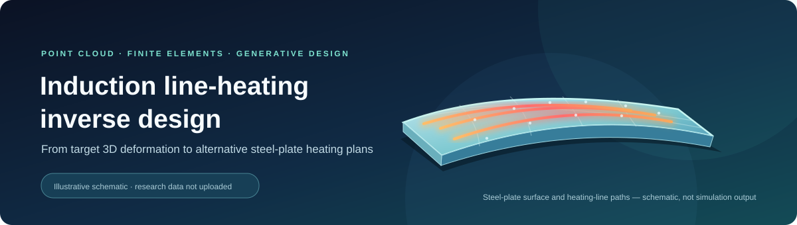
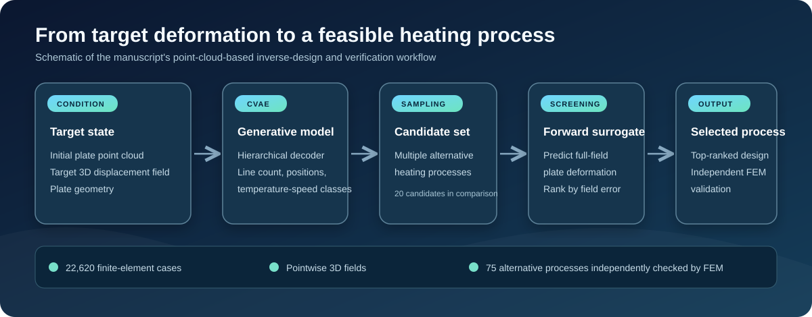

# Induction line-heating inverse design for steel plates

  <strong>Point-cloud conditions · Full-field deformation · Generative process planning</strong>

> [!IMPORTANT]
> **Repository status: documentation only.** No research dataset or model code has been uploaded. The images below are explanatory schematics, not finite-element outputs or evidence that data are available. **Do not use this repository URL as the manuscript's deposited-data location yet.**

## Research at a glance

Induction line heating helps form curved steel plates for shipbuilding. The inverse problem is to find heating settings that produce a desired three-dimensional plate deformation. Because different processes can lead to similar deformations, a single deterministic answer may miss useful alternatives.

The associated manuscript, **“Generative inverse design of induction line-heating processes for steel plates from three-dimensional displacement fields,”** studies this problem with point-cloud representations and a conditional variational autoencoder (CVAE).

| Stage | Role in the study |
| --- | --- |
| **Condition** | Initial plate point cloud, target pointwise 3D displacement field, and plate geometry |
| **Generate** | A hierarchical decoder proposes heating-line count, continuous positions, and temperature–speed classes |
| **Screen** | A frozen forward surrogate estimates full-field deformation and ranks candidate processes by target-field error |
| **Verify** | Selected alternatives are checked independently with finite-element simulations |

The manuscript reports **22,620 valid finite-element cases** and an experiment that generates **20 candidates per target** before selecting the best-ranked process. It also reports independent finite-element checks of **75 alternative processes**. These numbers describe the manuscript; the corresponding files are **not** currently present in this repository.

## Data availability

The manuscript currently states: “The datasets generated and analyzed during the current study are available from the corresponding author on reasonable request.”

A public data release here is pending confirmation by the authors and verification of sharing rights. If a subset is approved, we will identify exactly which cases it contains, provide file-level descriptions and units, and distinguish it from the complete study dataset. We will then update the manuscript's data availability statement so that it matches the actual deposited files and access conditions.

**No dataset DOI has been assigned to this repository.** Do not cite an empty repository as a data deposit.

## Planned documentation for an approved release

- A file inventory and an explanation of any train/test or validation subsets;
- Definitions and units for plate geometry, point coordinates, heating process parameters, and 3D displacement fields;
- The relationship between each released input, process condition, and finite-element output;
- Access, reuse, and citation information approved by the data owners.

The two SVG images in `assets/` were created as project illustrations based on the manuscript's concepts; they are not copied from the article figures and are not research data.
